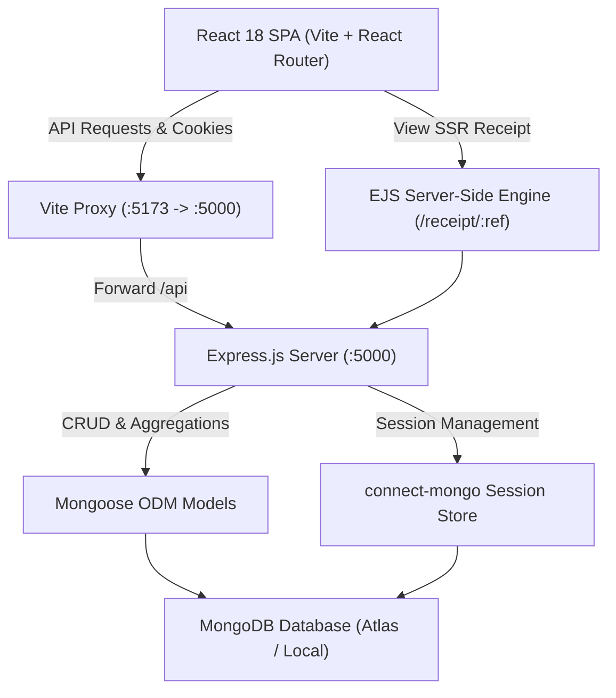
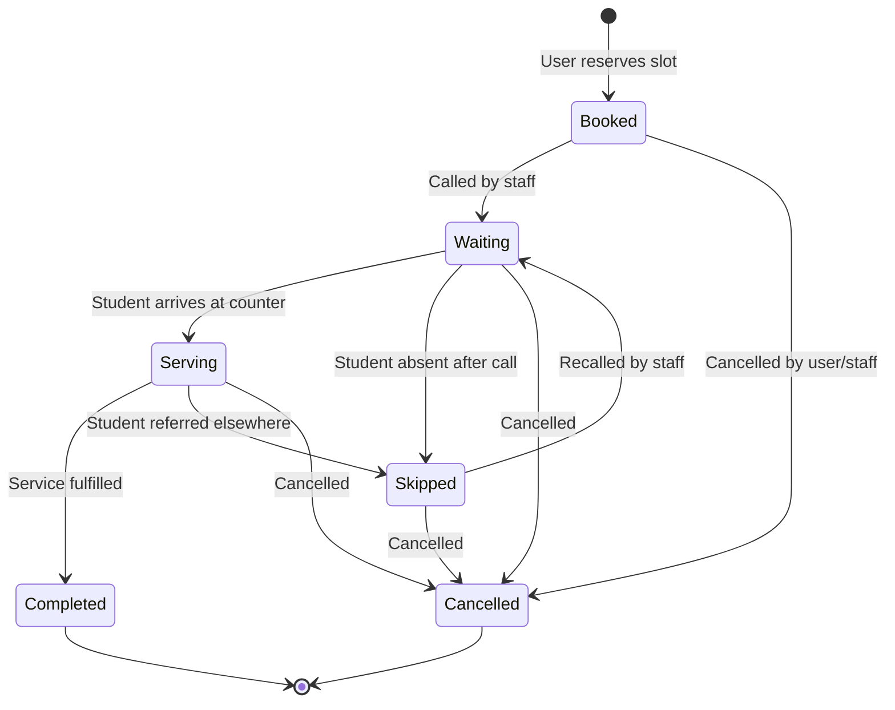
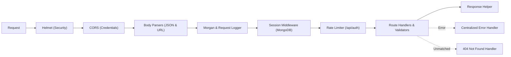

# QueueLess System Architecture

This document describes the software architecture, component relationships, data flow, concurrency model, and queue lifecycle within **QueueLess**.

---

## 1. High-Level Architecture Overview

---

## 2. Queue Lifecycle State Machine

Queue tokens and appointments adhere to a strict state machine to prevent invalid operational states (e.g., an officer cannot complete a student's appointment before marking them as serving).

### Transition Validation Matrix

| From State | Allowed Transitions | Blocked Transitions |
|---|---|---|
| `booked` | `waiting`, `serving`, `cancelled` | `completed`, `skipped` |
| `waiting` | `serving`, `skipped`, `cancelled` | `booked`, `completed` |
| `serving` | `completed`, `skipped`, `cancelled` | `booked`, `waiting` |
| `skipped` | `waiting` (recall), `serving`, `cancelled` | `booked`, `completed` |
| `completed` | *None (Terminal)* | Any |
| `cancelled` | *None (Terminal)* | Any |

---

## 3. Concurrency Safety & Token Generation Strategy

To eliminate double-booking when multiple students attempt to book the final available slot simultaneously:

1. **Atomic Capacity Verification:**
   Before booking, a database count query counts non-cancelled appointments for the specific `{ service, appointmentDate, timeSlot }`. If `count >= service.slotCapacity`, the server rejects the request with HTTP `409 Conflict`.

2. **Sequential Token Increment:**
   Tokens are indexed with a compound unique key:
   `{ service: 1, appointmentDate: 1, tokenSequence: 1 }`
   The sequence increments monotonically per service per day (e.g. `REC-001`, `REC-002`), ensuring strict arrival ordering.

3. **Dynamic Wait Time Estimation:**
   $$\text{Estimated Wait Time} = (\text{Position Ahead} + \text{IsCurrentlyServing}) \times \text{Service Average Duration}$$
   This calculation is performed dynamically using database records rather than hardcoded client estimates.

---

## 4. Middleware Execution Pipeline

Every incoming Express request passes through an ordered pipeline:

---

## 5. Security & Session Management

- **HTTP-Only Cookies:** Prevents Cross-Site Scripting (XSS) from reading sensitive session identifiers.
- **Session Fixation Defense:** Sessions are explicitly regenerated via `req.session.regenerate()` upon successful authentication.
- **Server-Derived Identity:** Never trusts user IDs or roles supplied in request payloads; extracts authenticated identity directly from `req.session.userId`.
- **Password Protection:** Uses `bcryptjs` with salt work factor of 10. Passwords are marked `{ select: false }` in Mongoose to prevent accidental exposure in API responses.
